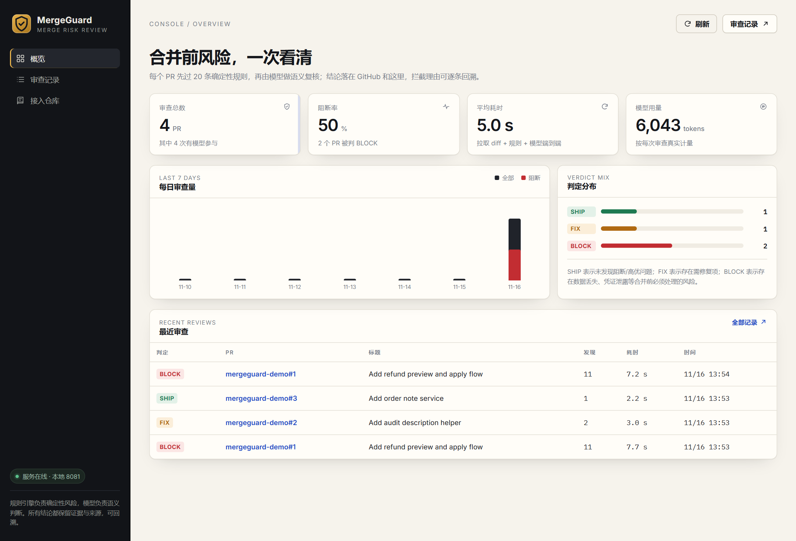
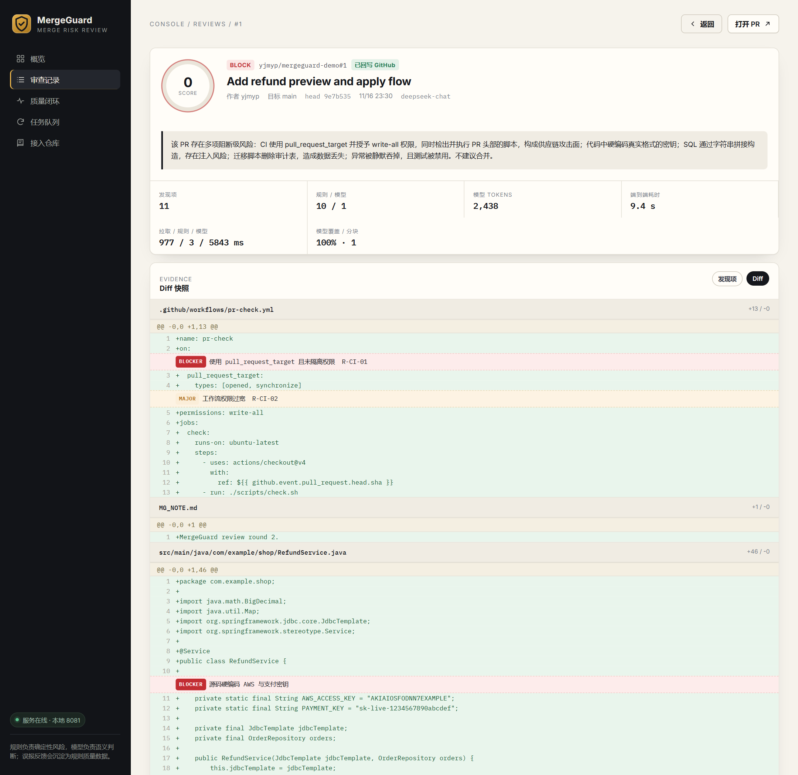
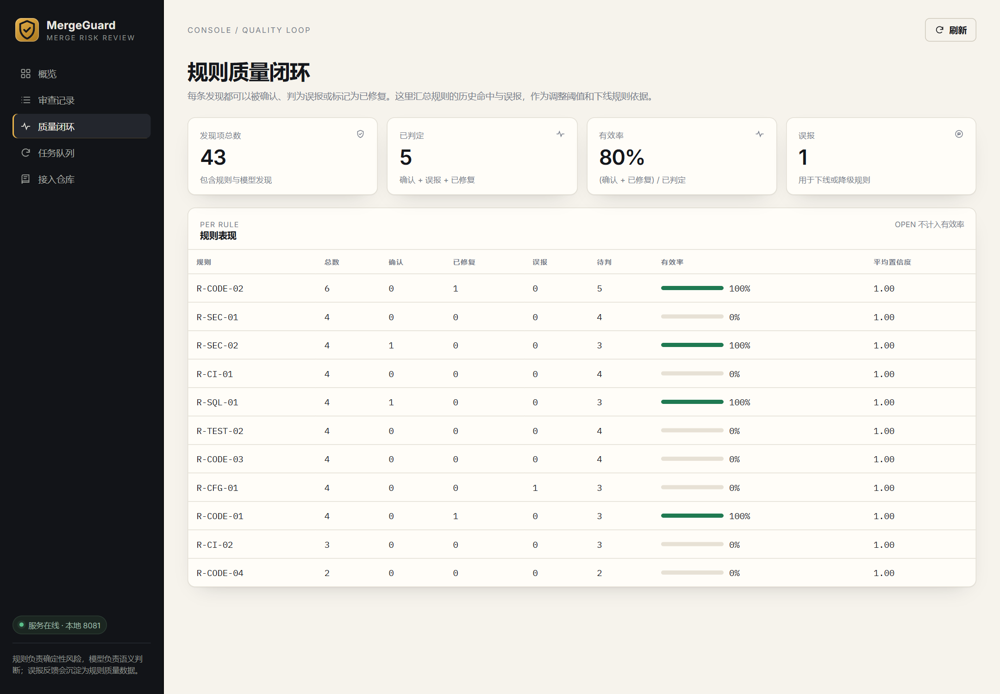
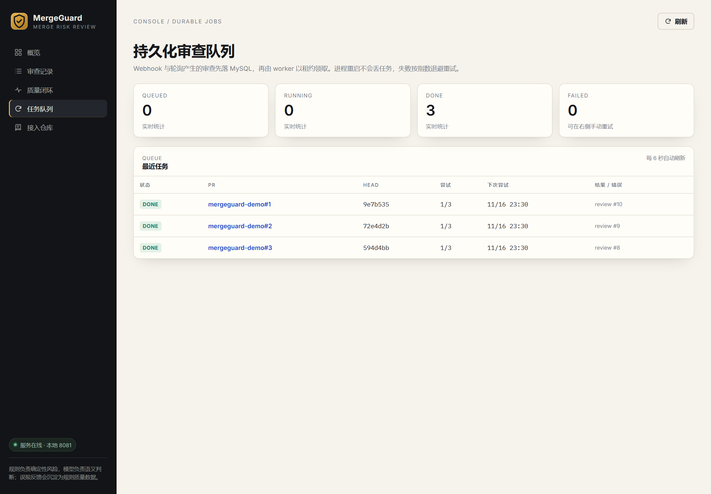
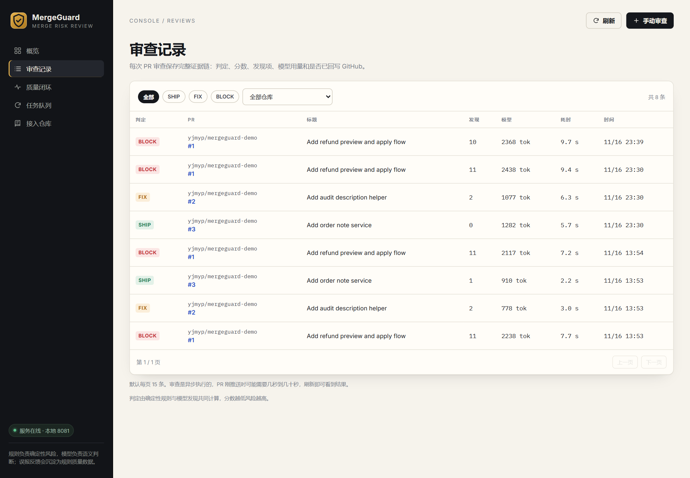
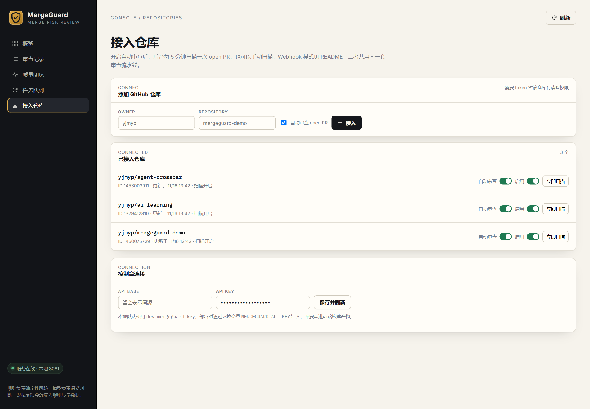
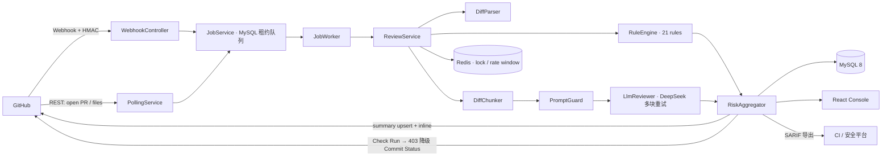

# MergeGuard

> 在 PR 合并前，把“会出事”的改动拦下来。规则负责确定性风险，模型负责语义风险，结论同时回写到 GitHub 和自建控制台。

`Java 21 · Spring Boot 3.5 · MySQL 8 · Redis 7 · React 19 · DeepSeek`

`63 个自动化测试 · 离线评测混合方案 F1 0.962 · 三个真实 PR 端到端跑通`



## 它解决什么问题

小团队 Review 的真实痛点不是“没人写评论”，而是：

- 破坏性 SQL、硬编码密钥、关闭 TLS 校验这类问题，人眼在长 diff 里很容易漏；
- 每个人 Review 标准不一致，同样的问题这次放过、下次拦下；
- 评论散落在 PR 里，没有可统计的结论，也没有办法回看某次 Review 的依据；
- 通用 AI Review 容易变成风格挑刺，真正阻断合并的问题反而被淹没。

MergeGuard 的做法是：**先跑 21 条确定性规则拿到高置信问题，再让模型只看新增代码做语义复核，最后用统一评分给出 SHIP / FIX / BLOCK，并把可定位的发现写成 GitHub 行内评论。** 系统只提示、不自动合并。

## 真实跑出来的结果

用公开的 [mergeguard-demo](https://github.com/yjmyp/mergeguard-demo) 仓库做了三个真实 PR，全部调用 DeepSeek 并把结果回写 GitHub：

| PR | 场景 | 判定 | 分数 | 发现 | 规则/模型 | tokens | 拉取/规则/模型/回写 |
|---|---|---|---|---|---|---|---|
| [#1](https://github.com/yjmyp/mergeguard-demo/pull/1) | 退款流程 + 破坏性迁移 + 工作流改动 | **BLOCK** | 0/100 | 11 | 10 / 1 | 2438 | 977 / 3 / 5843 / 1759 ms |
| [#2](https://github.com/yjmyp/mergeguard-demo/pull/2) | 审计辅助方法，异常被吞 | **FIX** | 87/100 | 2 | 2 / 0 | 1077 | 628 / 4 / 2748 / 2113 ms |
| [#3](https://github.com/yjmyp/mergeguard-demo/pull/3) | 只读订单备注 + 单测 | **SHIP** | 100/100 | 0 | 0 / 0 | 1282 | 685 / 4 / 2334 / 1918 ms |

三次审查都由 `mg_job` 持久化队列执行：状态 `DONE`，`attempts=1/3`，重启不会丢任务。数字来自 `docs/verification/e2e.json`，不是手写。

PR #1 中被拦下的典型问题：

- `.github/workflows/pr-check.yml` 使用 `pull_request_target` 同时检出 PR 头代码，并给了 `write-all` 权限；
- 迁移脚本 `DROP COLUMN` / `DROP TABLE`；
- `application.yml` 里提交了支付密钥；
- 用字符串拼接 SQL；
- 空 `catch` 吞异常；
- `@Disabled` 跳过测试；
- 模型额外识别出硬编码 AWS 凭证（该值命中占位符过滤被规则放过，由模型补充识别）。

控制台详情页（diff 快照、行级标注、反馈、分阶段耗时）：



质量闭环与持久化任务队列：




审查记录与仓库接入：




## 离线评测

`eval/cases.json` 有 32 个带标注片段（26 个风险、6 个清洁），同一批用例分别跑“规则 only”和“规则 + 模型”：

| 方案 | TP | FP | FN | Precision | Recall | F1 |
|---|---|---|---|---|---|---|
| 规则 only | 18 | 0 | 8 | 1.000 | 0.692 | 0.818 |
| 规则 + 模型 | 25 | 1 | 1 | 0.962 | 0.962 | **0.962** |

真实调用 DeepSeek，消耗 20276 tokens，模型耗时 53529 ms，行号命中率 1.000。唯一残余问题是 `race-create` 漏 1 误 1。复现：`mvn -q -Dmg.eval=true -Dtest=EvaluationTest test`，报告见 `docs/EVALUATION.md`。

## 架构



详细设计见 [docs/ARCHITECTURE.md](docs/ARCHITECTURE.md)。

## 技术栈

- **后端**：Java 21、Spring Boot 3.5、Spring MVC、JPA/Hibernate、MySQL 8、Redis 7、Bean Validation、Actuator + Micrometer、springdoc OpenAPI
- **前端**：React 19、TypeScript、Vite、React Router，自建 CSS 设计系统（不使用 Streamlit）
- **模型**：DeepSeek OpenAI-compatible Chat Completions，JSON 结构化输出，分块审查、单块重试、部分失败降级
- **集成**：GitHub REST API、Webhook HMAC-SHA256、Pull Request Review / Issue Comment、Check Run、Commit Status、SARIF 2.1.0
- **可靠性**：MySQL 持久化任务队列（租约、过期恢复、指数退避、幂等键）
- **测试**：JUnit 5、Mockito、MockMvc、AssertJ、H2 全上下文测试、JaCoCo，63 项测试中 62 通过、1 个评测用例默认跳过

## 快速开始

### 1. 准备依赖

- JDK 21、Maven 3.9+
- Node.js 20+
- MySQL 8（本地演示复用了已有 `offeragent` schema，通过 `DB_SCHEMA` 切换）
- Redis 7

### 2. 配置环境变量

```bash
export GITHUB_TOKEN=ghp_xxx          # 需要 repo 读权限；回写评论需要写权限
export DEEPSEEK_API_KEY=sk-xxx
export MERGEGUARD_API_KEY=your-console-key
export MERGEGUARD_WEBHOOK_SECRET=your-webhook-secret
export MERGEGUARD_POLL_ENABLED=true  # 无公网回调时用轮询
```

数据库连接可用 `SPRING_DATASOURCE_URL`、`MYSQL_USER`、`MYSQL_PASSWORD`、`DB_SCHEMA` 覆盖。

### 3. 启动

```bash
mvn -q test          # 63 total: 62 passed, 1 skipped (离线评测默认跳过)
mvn -q spring-boot:run

# 另开终端构建前端（构建产物会由 Spring Boot 托管）
cd frontend
npm ci
npm run build
cp -r dist/* ../src/main/resources/static/
```

访问 `http://127.0.0.1:8081/`，默认控制台 API Key 为 `dev-mergeguard-key`（仅本地）。

### 4. Docker Compose

```bash
cp .env.example .env   # 填入 GITHUB_TOKEN / DEEPSEEK_API_KEY
docker compose up --build
```

`docker-compose.yml` 会启动 MySQL、Redis 和应用；首次启动自动建表。**本机没有 Docker，因此 compose 未做本地实跑验证**，README 中明确标注，避免把“写了文件”说成“验证过”。

## 接入 GitHub

两种模式共用同一条审查流水线：

1. **轮询（默认，适合本地/无公网）**：控制台添加仓库后，每 5 分钟扫描 open PR，head SHA 没审过就入队。
2. **Webhook（适合部署）**：仓库 Settings → Webhooks → Add webhook：
   - Payload URL：`https://your-host/api/webhooks/github`
   - Content type：`application/json`
   - Secret：与 `MERGEGUARD_WEBHOOK_SECRET` 一致
   - Events：`Pull requests`

Webhook 会校验 `X-Hub-Signature-256`，按 `X-GitHub-Delivery` 做幂等，重复投递返回 `200 duplicate_ignored`。

本地已验证：

```text
bad signature  -> 401 invalid_signature
valid delivery -> 202 queued
duplicate      -> 200 duplicate_ignored
```

## 判定规则

| 判定 | 条件 | 含义 |
|---|---|---|
| `BLOCK` | 存在任一 BLOCKER | 合并前必须处理（数据丢失、凭证、命令/SQL 注入、CI 供应链等） |
| `FIX` | 无 BLOCKER，但有 MAJOR 或分数 < 75 | 建议修复后合并 |
| `SHIP` | 只有 MINOR / INFO | 可以合并，仍建议人工确认业务语义 |

分数从 100 开始，按 BLOCKER -40、MAJOR -12、MINOR -4、INFO -1 扣减，最低 0。

21 条规则按类别：

- 安全：硬编码凭证、私钥、`.env` 提交、SQL 拼接、命令执行、TLS 校验关闭、弱哈希、动态 eval
- 提示注入：diff 中出现“忽略此前指令/泄露系统提示”等针对 AI 审查的注入
- 数据：`DROP` / `TRUNCATE` / 无 `WHERE` 的 `DELETE`
- 可靠性：空 catch、过宽 catch
- 测试：跳过/禁用测试、主代码变更缺少测试
- 工程：调试输出、TODO、内网地址、超大 PR、CI `pull_request_target` / `write-all`

模型发现还会经过提示注入中和、置信度过滤（默认 `minConfidence=0.85`）、路径/行号合法性校验；TESTING / MAINTAINABILITY / REVIEW_COST 只由确定性逻辑负责，避免模型用“感觉”扣分。

## API

所有 `/api/**`（Webhook 除外）都需要 `X-API-Key`；未配置 Key 时服务 fail-closed 返回 503。

| 方法 | 路径 | 说明 |
|---|---|---|
| GET | `/api/overview` | 总览：判定分布、7 日趋势、最近审查 |
| GET | `/api/reviews` | 分页查询，支持 `verdict`、`repo` 过滤 |
| GET | `/api/reviews/{id}` | 审查详情 + 发现项 |
| GET | `/api/reviews/{id}/diff` | 落库的 diff 快照（行级标注） |
| GET | `/api/reviews/{id}/sarif` | 导出 SARIF 2.1.0 |
| POST | `/api/findings/{id}/feedback` | 标记 `ACCEPTED` / `DISMISSED` / `FIXED` |
| GET | `/api/quality` | 按规则统计有效率、采纳率、平均置信度 |
| GET | `/api/jobs` | 任务队列分页 |
| GET | `/api/jobs/stats` | 队列状态计数 |
| POST | `/api/jobs/{id}/retry` | 失败任务重试 |
| POST | `/api/reviews` | 手动触发：`{owner,name,prNumber,publish}` |
| GET | `/api/repos` | 已接入仓库 |
| POST | `/api/repos` | 添加仓库（会调用 GitHub 校验） |
| PATCH | `/api/repos/{id}` | 开关 `enabled` / `autoReview`，配置仓库策略 |
| POST | `/api/repos/{id}/scan` | 立即扫描 open PR |
| POST | `/api/webhooks/github` | GitHub Webhook（HMAC） |

Swagger：`http://127.0.0.1:8081/swagger-ui.html`

## 关键设计

- **持久化队列**：Webhook/轮询只入队，`mg_job` 用租约 claim、过期恢复、指数退避、`dedupe_key` 幂等；进程重启不丢任务。
- **规则优先**：确定性规则先给出可解释的阻断项，模型只补语义问题，避免“全靠模型拍脑袋”。
- **分块审查**：`DiffChunker` 按字符上限切块，显式给每行加 `+L行号|` 标记，块级重试，合并摘要；记录 `llm_chunks` 与覆盖率。
- **提示注入防御**：`PromptGuard` 中和“ignore previous instructions”、中文越权指令、闭合标签逃逸；命中计入 `injectionNeutralized`。
- **置信度校准**：模型只报安全/可靠性/正确性等语义类别，低于 `0.85` 丢弃；测试覆盖和可维护性由规则负责。
- **按 head SHA 幂等**：同一 PR 同一提交只审一次；推新提交生成新记录，旧结论作为快照保留。
- **并发保护**：Redis `SET NX` 锁住 `repo#pr@sha`；即使锁不可用，数据库唯一约束和任务幂等仍然兜底。
- **行内评论有边界**：只有落在 diff 新增行、达到 `minPublishSeverity`、且不超过 `maxInlineComments` 才发 inline，避免 GitHub 422。
- **不重复刷屏**：汇总评论用 `<!-- mergeguard:summary -->` 标记做 upsert；同一文件同类别 ±3 行内的问题，新提交不再重复评论。
- **发布降级**：Check Run 需要 GitHub App；PAT 调用返回 403 时自动降级为 Commit Status。汇总评论、行内评论、Check Run 任一成功都算已发布，失败写入 `publishError`。
- **模型降级**：未配置 Key、超时、单块 JSON 解析失败都保留其余块与规则结果，审查不会整体中断。
- **成本可控**：按块限制字符数与 `max_tokens`，记录真实 tokens 和分阶段耗时。
- **质量闭环**：每条发现可标 `ACCEPTED` / `DISMISSED` / `FIXED`，`/api/quality` 按规则算采纳率，用于后续调阈值和规则。
- **仓库策略**：支持 `ignoredPaths`、`disabledRules`、`minPublishSeverity`、`maxInlineComments`，不同仓库可以有不同严格度。

## 测试与验证

```text
Tests run: 63, Failures: 0, Errors: 0, Skipped: 1
```

覆盖 diff 行号映射、21 条规则、风险聚合/去重、分块与提示注入、LLM JSON 解析与重试、HMAC、API Key fail-closed、任务租约/重试、SARIF、H2 全上下文启动。

真实端到端证据在 [docs/verification/e2e.json](docs/verification/e2e.json)：三次审查的判定、分数、tokens、分阶段耗时、任务状态与发现项均来自数据库落库结果，不是手写。`docs/evaluation.json` 与 `docs/EVALUATION.md` 是离线评测的机器产出。

## 已知限制

- 规则是启发式，可能误报；当前阈值面向“宁可提示，不漏阻断”。
- 模型只看到新增代码和有限上下文，无法理解完整业务语义；结论需要人工确认。
- 行内评论只能定位到 diff 新增行，删除行/跨文件问题会进入汇总。
- Check Run 需要 GitHub App；当前用 PAT 演示，403 时降级为 Commit Status（已实测）。
- 多租户、按安装维度计费、GitHub App 安装态还没做。
- 轮询模式最长有 5 分钟延迟；生产建议 Webhook。
- 演示环境复用了本机 `offeragent` schema，生产请用独立数据库并接 Flyway。
- 演示库做过一次手工归一化（旧 `mg_finding.status`、可空列、仓库策略默认值）；新库由 `ddl-auto=update` 直接建对，不需要这一步。
- 本机没有 Docker，`docker-compose.yml` 未做本地实跑验证。

## License

MIT
